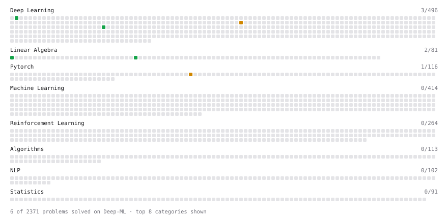

# Deep-ML

My machine learning practice from [Deep-ML](https://www.deep-ml.com). Every solution here was written by hand.

**3** solved · 3 problems · 0 labs · 0 math

[**Browse the interactive portfolio**](https://iKintosh.github.io/deep-ml/) to replay this filling in over time.

## Problems

| | Difficulty | Solved | |
| --- | --- | --- | --- |
| [Matrix-Vector Dot Product](https://www.deep-ml.com/problems/1) | easy | 2026-11-17 | [solution](problems/0001-matrix-vector-dot-product) |
| [Token Embedding Lookup Table](https://www.deep-ml.com/problems/945) | easy | 2026-11-17 | [solution](problems/0945-token-embedding-lookup-table) |
| [Numerically Stable Softmax](https://www.deep-ml.com/problems/1227) | medium | 2026-11-16 | [solution](problems/1227-numerically-stable-softmax) |

---

_This file is regenerated by Deep-ML on every push._
